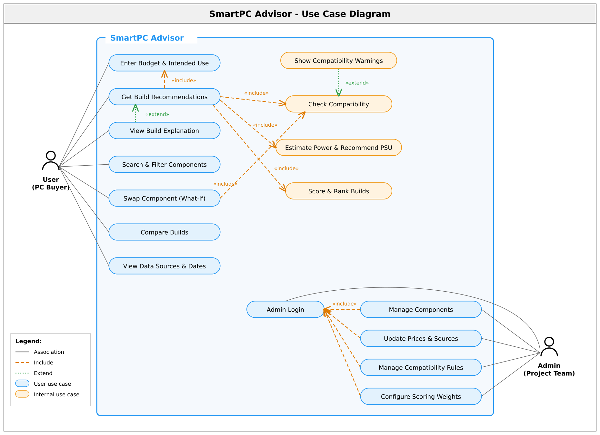

# Requirement Analysis – SmartPC Advisor

## Introduction

This repository documents the requirement analysis for **SmartPC Advisor**, a rule-based web application that recommends compatible, budget-friendly desktop PC builds. Users enter a budget in Bangladeshi Taka (BDT) and an intended use (gaming, programming or general use). The system then suggests complete builds from seven component types: CPU, GPU, RAM, motherboard, storage, power supply and case.

The purpose of this repository is to record how the project's requirements were gathered, analysed, documented and validated. It follows the requirements determination process taught in CSE347 (Information System Analysis and Design), Lecture 5.

## What is Requirement Analysis?

Requirement analysis is the process of identifying, gathering and defining what stakeholders need from a software system. Requirements determination turns the high-level goal of a project into detailed requirements, and those requirements become the inputs for system models. A requirement is a statement of **what the system must do** or **a characteristic it must have**.

For SmartPC Advisor, this means turning the goal *"help users build a compatible PC within their budget"* into specific features and quality targets the team can design, build and test.

**Importance in the Software Development Lifecycle (SDLC):**
- Requirements determination is the single most critical step of the SDLC. More than 50% of system failures come from requirement problems.
- The top causes of failed software projects are incomplete requirements (13.1%) and lack of user involvement (12.4%) (Standish Group).
- Changes are cheap at this stage but expensive after design and coding have started.
- Clear requirements guide design, development and testing, and keep a 12-week student project within scope.
- They give the team, the users and the course supervisor a shared understanding of what will be delivered.

## Key Activities in Requirement Analysis

Requirement analysis for SmartPC Advisor involves five key activities:

- **Requirement Gathering:**
  Collecting information from stakeholders using the techniques from Lecture 5:
  - *Questionnaire* (many users): an online form for students and PC-building Facebook groups covering typical budgets, intended uses and how they choose parts today.
  - *Interviews* (users know their needs): one-on-one sessions with first-time builders, experienced builders and a computer-shop salesperson.
  - *Document analysis* (existing documents): manufacturer spec sheets, CPU/motherboard support lists, PSU guides and Bangladeshi retailer price lists.

- **Requirement Elicitation:**
  Uncovering the real needs behind what users say:
  - *JAD session* (group discussion): the project team, the course supervisor and two or three target users agree on core features and priorities.
  - *Observation*: watching users plan a build with their current method (YouTube, forums, shop advice) to find hidden workarounds and mistakes.

- **Requirement Documentation:**
  Recording requirements in a clear, structured format. This includes functional and non-functional requirement lists (below), a use case diagram and acceptance criteria for each feature.

- **Requirement Analysis and Modeling:**
  Refining requirements with the analysis strategies from Lecture 5:
  - *Problem analysis:* users waste time and still end up with incompatible builds. Result: an automatic compatibility check.
  - *Root cause analysis (5 Whys):* beginners buy incompatible parts because the rules are spread across many spec sheets. Result: a central rule base with plain-language warnings.
  - *Duration analysis:* hours of manual research across many sites. Result: a one-screen recommendation.
  - *Activity-based costing:* manual cross-checking of specs and prices is the costliest step. Result: a single component database.
  - *Benchmarking:* existing tools check compatibility but do not recommend builds for a BDT budget. Result: budget-based recommendations in BDT.
  - *Outcome analysis:* users want a build they can trust, not a parts list. Result: weighted scoring with an explanation for each build.
  - *Technology analysis:* a rule-based engine is enough for version 1. Result: no AI/ML is needed.
  - *Activity elimination:* remove the manual PSU calculation and the re-search after every change. Result: an automatic PSU estimate and what-if part swaps.

- **Requirement Validation:**
  Checking that the requirements are correct, complete and feasible through supervisor reviews, a JAD walkthrough, interview follow-up reports and a usability walkthrough with potential users before the final demonstration.

## Types of Requirements

Requirements fall into two main types: functional and non-functional. Below are the requirements for SmartPC Advisor.

### Functional Requirements

Functional requirements describe **what the system must do**: its features, processes and data. They flow into functional models (use cases), structural models (data models) and behavioural models.

**Functional requirements for SmartPC Advisor:**
- Users can enter a budget (BDT), an intended use (gaming, programming, general use) and optional preferences.
- The system generates complete PC builds that stay within the user's budget.
- The system checks compatibility between parts: CPU–motherboard socket, RAM type and slots, case size and GPU/cooler clearance, PSU wattage and connectors, and storage interface.
- The system shows a plain-language warning for every conflict, and flags missing data as "unknown" rather than assuming compatibility.
- The system estimates a build's power draw and recommends a PSU with a safety margin.
- The system ranks builds using a weighted score: workload suitability 45%, value for money 30%, budget use 15%, upgrade potential 10%.
- The system explains each recommended build: total cost, score breakdown and why key parts were chosen.
- Users can search and filter components by type, brand, price and key specifications.
- Users can swap a component (what-if analysis) and see compatibility, cost, power and score update immediately.
- Users can compare two or three builds side by side with cost and performance charts.
- The system shows the data source and last-updated date for each price and specification.
- Administrators can add, update and remove components, prices, compatibility rules and scoring weights.

### Non-functional Requirements

Non-functional requirements describe **how well the system must perform**. They are grouped by the categories in Lecture 5.

**Non-functional requirements for SmartPC Advisor:**
- **Operational:** The application must run in current Chrome, Firefox and Edge browsers on desktop and mobile without installation.
- **Operational:** The interface must be responsive on screens from 360 px to 1920 px wide.
- **Performance:** The system should return build recommendations within 3 seconds for a catalog of up to 300 components.
- **Performance:** Pages should load within 2 seconds on a typical broadband connection.
- **Performance:** The system should support at least 50 concurrent users during the demonstration.
- **Security:** Only authenticated administrators can add or edit components, prices and rules.
- **Security:** All user inputs (budget range, use case) must be validated to block invalid or malicious requests.
- **Cultural & political:** Prices must be shown in BDT, and technical terms explained in simple English.
- **Cultural & political:** Every data source must be credited, and prices must be labelled as recorded, not live.
- **Usability:** A first-time user should get a recommendation in 3 steps or fewer without help.

## Use Case Diagrams

Use case diagrams show how users (actors) interact with the system's functions (use cases). They help stakeholders see what the system will do, who uses each function and where the system boundary lies.

**Benefits of Use Case Diagrams:**
- Turn the requirement list into a picture that non-technical users and the supervisor can follow.
- Show which actor uses each feature, and which functions are shared through «include» and «extend».
- Mark the system boundary, which makes it clear what is out of scope (e.g. live prices, user accounts).
- Serve as the basis for detailed use case descriptions and test cases.

### SmartPC Advisor Use Case Diagram

**Actors:**
- User (PC Buyer)
- Admin (Project Team)

**Use Cases:**
- Enter Budget & Intended Use
- Get Build Recommendations (includes Check Compatibility, Estimate Power & Recommend PSU, Score & Rank Builds)
- View Build Explanation (extends Get Build Recommendations)
- Search & Filter Components
- Swap Component (What-If) (includes Check Compatibility)
- Compare Builds
- View Data Sources & Dates
- Show Compatibility Warnings (extends Check Compatibility when a conflict is found)
- Admin Login
- Manage Components (Admin)
- Update Prices & Sources (Admin)
- Manage Compatibility Rules (Admin)
- Configure Scoring Weights (Admin)

## Acceptance Criteria

Acceptance criteria are specific, measurable conditions a feature must meet to be considered complete. They turn each requirement into something the team can test and the supervisor can check.

**Importance of Acceptance Criteria in Requirement Analysis:**
- Define exactly when a feature is "done".
- Prevent misunderstandings between the team, users and the supervisor.
- Make every requirement testable, so test cases come straight from them.
- Reduce scope creep and rework within the 12-week schedule.

### Example: Acceptance Criteria for the Build Recommendation Feature

1. The user must be able to enter a budget between BDT 30,000 and BDT 500,000 and choose an intended use before requesting a recommendation.
2. The system must return at least one complete build containing all seven component types, or a clear message if no build fits the budget.
3. The total cost of every recommended build must be at or below the user's budget.
4. Every recommended build must pass all essential compatibility checks. A build that fails any check must never be shown as recommended, whatever its score.
5. Each build must show its total cost in BDT, the score breakdown (workload, value, budget use, upgrade potential) and a short reason for each key part.
6. The recommended PSU wattage must be at least the estimated power draw plus the defined safety margin, and must be labelled as an estimate.
7. Recommendations must appear within 3 seconds of the user submitting the form.

### Example: Acceptance Criteria for the What-If Component Swap Feature

1. The user must be able to replace any part in a recommended build with another part of the same type.
2. After a swap, compatibility, total cost, estimated power and score must update without reloading the page.
3. If the new part causes a conflict, the system must show a warning that names both parts and explains the problem in plain language.
4. The user must be able to undo the swap and return to the original build.

Acceptance criteria ensure that SmartPC Advisor delivers what its users and supervisor expect and is ready for the final demonstration.
